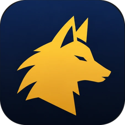

<h1 align="center">Aion 2 Pet Tracker</h1>

Free pet collection and soul farming tracker for <b>Aion 2</b>, with an in-game overlay and a minimap of soul mobs. 
<b><a href="https://github.com/Couga54/aion2-pet-tracker-releases/releases/latest/download/Aion2PetTracker-Setup.exe">⬇ Download for Windows</a></b> · <a href="#русский">Русский</a>

---

Collecting all 200 pets in Aion 2 means farming souls from the right mobs. The game doesn't show how many souls you still need across the whole collection, or where to get them. Aion 2 Pet Tracker keeps track of it for you:

- **Your whole collection fills in by itself.** When you enter your character, the tracker reads every pet's level and soul count. No typing or screenshots.
- **Souls are counted live.** Every soul you pick up is added to the right pet at once.
- **Overlay on top of the game.** It shows your favorite pets, or the pets nearby whose souls you still need, with a compass arrow and distance to the nearest mob that drops each soul.
- **Minimap of soul mobs.** It shows spawn points and live mobs that drop souls of the pets you track, colored by pet category (Cogni, Fera, Natura, Varian).
- **Level-up and max-level animations, plus a log of picked-up souls.**
- **Lock the overlay and minimap** so clicks pass through to the game. Press **Ctrl+Shift+L** right from the game.
- **Table of all pets** with filters by category, level and favorites, and the souls each one still needs.
- **Updates itself.** A new version installs with one click and keeps your data.
- **English and Russian interface.**

## Download and install

1. **[Download the latest installer](https://github.com/Couga54/aion2-pet-tracker-releases/releases/latest/download/Aion2PetTracker-Setup.exe)** (Windows 10/11, x64) and run it. It installs for the current user. If .NET 10 Desktop Runtime is missing, the installer downloads it from Microsoft once; Windows asks for administrator permission for that step.
2. Install the free **[Npcap](https://npcap.com/#download)**. The tracker needs it to read your collection and count souls.
3. Run the game in **windowed** or **borderless** mode so the overlay can be drawn on top of it.
4. Start the tracker **before** entering your character.

The installer is not code-signed yet, so Windows SmartScreen may warn about it. Click **More info → Run anyway**.

All versions and change notes are on the **[Releases](https://github.com/Couga54/aion2-pet-tracker-releases/releases)** page.

## How it works

The tracker never reads game memory and never injects anything into the game client. It passively listens to the game's network traffic through Npcap, the same way DPS meters work. When you enter the world, the game sends your whole pet collection; after that, each picked-up soul and the positions of nearby mobs arrive the same way.

Game rules may prohibit third-party traffic analyzers. Use the tracker at your own discretion.

## FAQ

**Does it work without Npcap?** You can still edit pets and souls by hand, but the collection won't load and souls won't be counted automatically.

**My collection didn't load.** Start the tracker first, then enter your character or switch characters. The game sends the collection only when you enter the world.

**The overlay isn't visible.** Switch the game to windowed or borderless mode; exclusive fullscreen hides other windows.

**Where is my data?** In `%AppData%\Aion2PetTracker`. Updates keep it.

**Something doesn't work.** Click **Save for support** in the tracker. It saves a zip with the log and settings to your desktop. Then [open an issue](https://github.com/Couga54/aion2-pet-tracker-releases/issues) and attach it.

This repository hosts the installers and release notes only; the source code is private.

---

<h2 id="русский">Русский</h2>

**Aion 2 Pet Tracker** — бесплатный трекер коллекции питомцев и фарма душ для **Aion 2** с оверлеем поверх игры и мини-картой мобов с душами.

**[⬇ Скачать последнюю версию](https://github.com/Couga54/aion2-pet-tracker-releases/releases/latest/download/Aion2PetTracker-Setup.exe)** (Windows 10/11, x64)

Чтобы собрать всех 200 питомцев, нужно выбить души с нужных мобов. Игра не показывает, сколько душ осталось по всей коллекции и где их фармить. Трекер следит за этим сам:

- **Коллекция заполняется сама.** При входе на персонажа трекер узнаёт уровень и души каждого питомца. Ничего вводить и сканировать не нужно.
- **Души считаются на ходу.** Каждая подобранная душа сразу добавляется нужному питомцу.
- **Оверлей поверх игры.** Показывает избранных питомцев или питомцев поблизости, с которых ещё нужна душа, со стрелкой-компасом и расстоянием до ближайшего моба.
- **Мини-карта мобов с душами.** На ней точки появления и живые мобы, с которых падают души отслеживаемых питомцев, цветом категории (разумные, дикие, природные, мутанты).
- **Анимация нового и максимального уровня, журнал подобранных душ.**
- **Закрепление оверлея и мини-карты:** клики проходят в игру. **Ctrl+Shift+L** прямо из игры.
- **Таблица всех питомцев:** фильтры по категории, уровню и избранному, сколько душ ещё нужно.
- **Обновляется сам:** новая версия ставится в один клик, данные сохраняются.
- **Интерфейс на русском и английском.**

### Установка

1. **[Скачайте установщик](https://github.com/Couga54/aion2-pet-tracker-releases/releases/latest/download/Aion2PetTracker-Setup.exe)** и запустите. Ставится для текущего пользователя. Если нет .NET 10 Desktop Runtime, установщик один раз скачает его с сайта Microsoft; для этого шага Windows спросит права администратора.
2. Установите бесплатный **[Npcap](https://npcap.com/#download)**: без него трекер не прочитает коллекцию и не посчитает души.
3. Игра — в оконном режиме или «окно без рамки», иначе оверлей не виден.
4. Запускайте трекер **до** входа на персонажа.

Установщик пока не подписан, поэтому Windows SmartScreen может предупредить. Нажмите **Подробнее → Выполнить в любом случае**.

### Как это работает

Трекер не читает память игры и ничего не внедряет в клиент. Он пассивно слушает сетевой трафик игры через Npcap, как DPS-метры. При входе в мир игра присылает всю коллекцию питомцев, а дальше так же приходят подобранные души и позиции мобов рядом.

Правила игры могут запрещать сторонние анализаторы трафика. Пользуйтесь трекером на своё усмотрение.

Проблема? Нажмите в трекере **«Сохранить для отправки»** над журналом: на рабочем столе появится архив с журналом и настройками. [Создайте issue](https://github.com/Couga54/aion2-pet-tracker-releases/issues) и приложите его.
